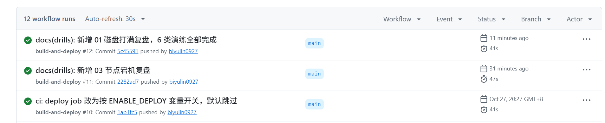
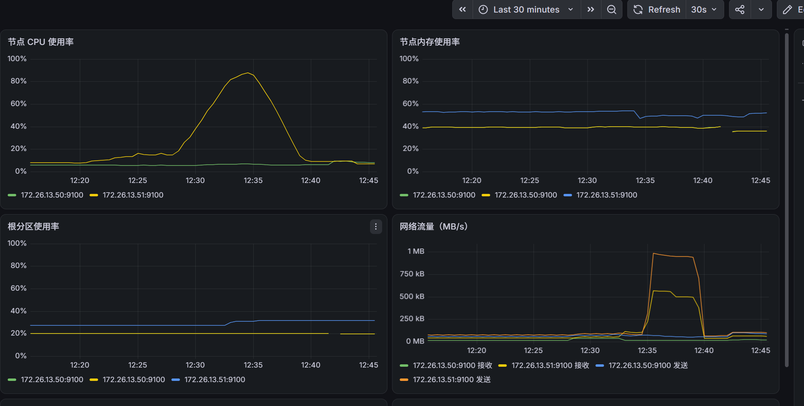
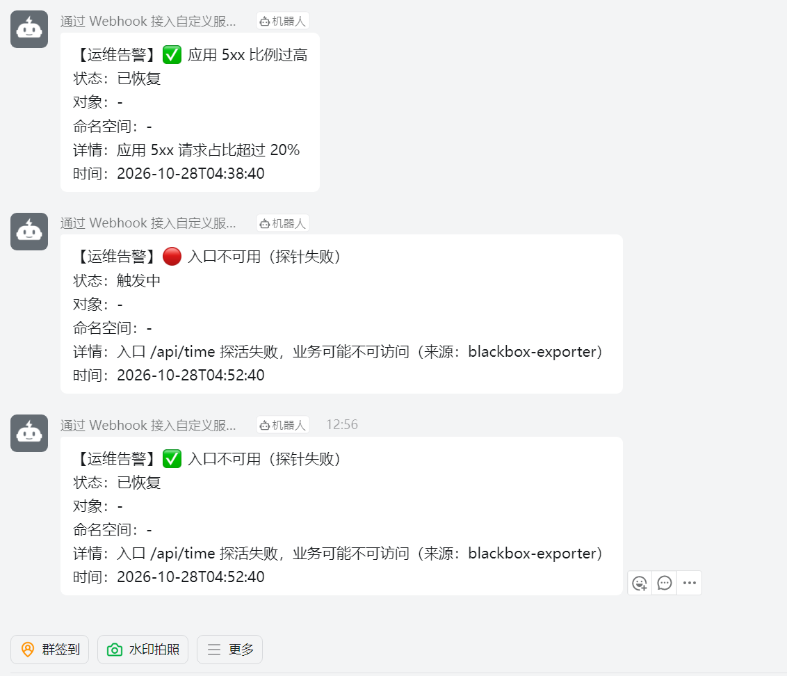
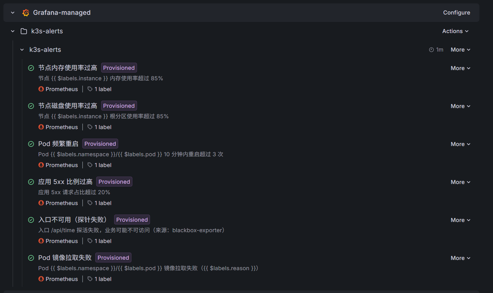
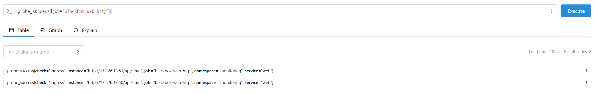
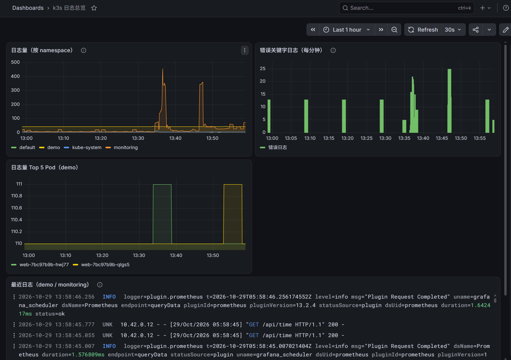
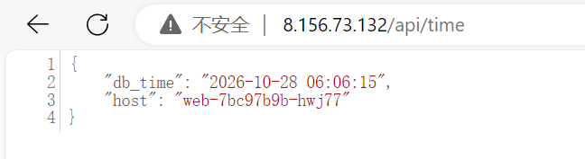
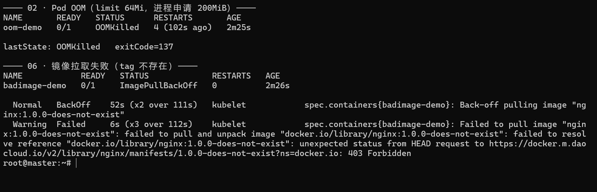

# k3s 一体化运维平台

在 2 台 2C4G 阿里云 ECS 上搭建的轻量级业务运维平台：k3s 集群承载 Flask + MySQL 业务，配套 Ingress、监控告警、日志与故障演练。

> 这是一个**学习 + 简历**项目，目标是完整走一遍「部署 → 观测 → 故障 → 复盘」的运维闭环。

## 架构

```
开发者 push ──▶ GitHub Actions ──▶ 镜像仓库(ghcr.io)
                                      │ kubectl set image
                                      ▼
┌──────────────────────────────────────────────────────────┐
│ k3s 集群（2 节点，172.26.0.0/20）                          │
│                                                          │
│  ns: demo                      ns: monitoring            │
│  ┌─────────┐  ┌──────────┐     ┌────────────┐            │
│  │ web ×2  │─▶│ mysql    │     │ Prometheus │            │
│  │ Flask   │  │ Stateful │     │ Alertmgr   │            │
│  └────┬────┘  └──────────┘     │ Grafana    │            │
│       │                        └─────┬──────┘            │
│       ▼                              ▼                   │
│   Traefik Ingress（80/443）      Webhook Relay ──▶ 钉钉    │
└──────────────────────────────────────────────────────────┘
```

## 技术栈

| 类别 | 组件 |
|---|---|
| 容器编排 | k3s v1.36.5（Kubernetes 轻量发行版） |
| 入口 | Traefik Ingress Controller（svclb 暴露 80/443） |
| 业务 | Python Flask + PyMySQL + prometheus_client |
| 数据库 | MySQL 8.0（StatefulSet + local-path 存储） |
| 监控 | Prometheus + Grafana（NodePort 30300）+ Alertmanager |
| 告警 | Grafana 告警规则 → Webhook Relay → 钉钉 |
| 配置管理 | Ansible（规划中） |
| 自动化 | GitHub Actions |

## 环境信息

| 角色 | 主机名 | 私网 IP | 公网 IP | 规格 | 磁盘 |
|---|---|---|---|---|---|
| master | master | 172.26.13.50 | 8.156.73.132 | 2 vCPU / 4 GiB | 40 GiB |
| worker | k3s-node1 | 172.26.13.51 | 8.156.68.82 | 2 vCPU / 4 GiB | 40 GiB |

- 地域：华东/西南（cn-chengdu），Ubuntu 22.04.5，内核 5.15
- 镜像加速：`/etc/rancher/k3s/registries.yaml`（docker.m.daocloud.io 等）
- 主机名曾于 10-27 变更，详见 [`drills/08-node-rename.md`](drills/08-node-rename.md)

## 进度

- [x] 双节点 k3s 集群，节点 Ready
- [x] 配置镜像加速，解决 docker.io 超时
- [x] Traefik Ingress 贯通（`pathType: Prefix`，浏览器 200）
- [x] Flask + MySQL 业务部署（`/api/time` 返回数据库时间，`/metrics` 暴露指标）
- [x] GitHub Actions 自动发布（push → ghcr 镜像 → 滚动更新 → 失败回滚）
- [x] Prometheus + Grafana 监控看板（8 个面板）
- [x] 告警链路（Grafana 规则 → Webhook Relay → 钉钉，9 条规则，核心 8 条已实测触发与恢复）
- [x] master 升配到 2C4G
- [x] 入口可用性探针（blackbox-exporter + Grafana 告警规则）
- [x] 6 类故障演练（01–06）全部完成，均有复盘
- [x] Loki + Promtail 日志查询（Grafana 里可直接按 namespace / pod 检索）

CI 最近的推送均通过（`构建并推送镜像` 成功，`部署到 k3s` 按 `ENABLE_DEPLOY` 开关跳过，
不会再出现红叉）：



## 当前状态（2026-10-29 下午）

**已完成**

| 项 | 说明 |
|---|---|
| 集群 | 2 节点 k3s v1.36.5，均 Ready，无异常 Pod |
| 业务 | Flask + MySQL，`/api/time` 三处入口均 200；readiness 查库，DB 挂了返回 503 而不是 500 |
| 入口 | Traefik + svclb，80/443 正常，`pathType: Prefix` |
| 监控 | Prometheus + Grafana（NodePort 30300），8 面板看板 |
| 告警 | 9 条规则（内存/磁盘分层/Pod 重启/5xx/入口探活/镜像拉取/OOM/MySQL），含根因关联抑制 → Relay → 钉钉 |
| 日志 | Loki + Promtail，保留 7 天；「k3s 日志总览」看板 4 个面板 |
| 探针 | blackbox-exporter 探 `http://<node-ip>/api/time`，30s 一次 |
| 复盘 | `drills/00`、`drills/01`、`drills/02`、`drills/03`、`drills/04`、`drills/05`、`drills/06`、`drills/07`、`drills/08` |
| 主机名 | 已固化 `master` / `k3s-node1`，幽灵节点已清理 |

**进行中 / 待处理**

1. **监控与被监控对象同节点**：03/04/01 三次演练都出现"节点或磁盘一出事，Prometheus/Grafana 一起失联"
   （Loki 已刻意放到 master，但指标栈仍在 worker，属于结构性改进，需要迁移 PVC）
2. **6443 安全组**：当前对 `118.113.89.85` 开放，需确认是 `/32` 还是 `0.0.0.0/0`
3. **GitHub Actions 部署 job 默认跳过**：托管 Runner 的出口 IP 不在 6443 白名单，连不上 API Server。
   已加 `ENABLE_DEPLOY` 开关（见备注），要真正自动部署需自托管 Runner
4. **告警规则来源**：`create-alerts.py` 是早期 API 方式，规则现已全部由 provisioning 文件下发，
   该脚本仅作参考，可择机删除

> 已闭环：磁盘分层告警（01）、重启窗口 + OOM 专项（02）、根因抑制 + readiness 查库（04）、
> 镜像拉取告警（06）、配置声明式化（05）、入口探针（08）、FDB 自愈复验（08）、日志与看板、9 条告警规则

**下次开工顺序**

1. 确认环境：`kubectl get nodes`、`kubectl -n monitoring get pods`、`curl http://127.0.0.1/api/time`
2. 落地 03/04/01 三条演练得出的共性改进：监控拆分、告警抑制
3. 给日志看板补一张截图，替换 README 里的占位说明
4. 补演练汇总（MTTR）

## 目录结构

```
k3s-ops-lab/
├── README.md
├── ansible/                  # 节点初始化 playbook（规划中）
├── app/                      # 业务应用
│   ├── app.py                # Flask 服务（/api/time、/metrics、/healthz）
│   ├── requirements.txt
│   ├── Dockerfile
│   └── k8s/                  # 00-namespace / 10-mysql / 20-web / 30-ingress
├── .github/workflows/        # build-deploy.yaml
├── monitoring/               # 监控配置
│   ├── values-prometheus.yaml
│   ├── grafana-standalone.yaml   # 独立 Grafana，含数据源与告警 provisioning
│   ├── blackbox.yaml         # 入口探针：blackbox-exporter + Probe
│   ├── servicemonitor-web.yaml   # 采集业务 /metrics（5xx 规则的数据源）
│   ├── loki.yaml             # 日志存储（单机，文件系统 + PVC，跑在 master）
│   ├── promtail.yaml         # 日志采集 DaemonSet（/var/log/pods → Loki）
│   ├── grafana-loki-dashboard.json   # 「k3s 日志总览」看板（4 面板）
│   ├── create-alerts.py      # 早期 API 建规则脚本（已被 provisioning 取代）
│   ├── grafana-dashboard.json
│   └── feishu-relay/         # Webhook 转发（实际发钉钉，历史命名）
│       ├── app.py
│       ├── deploy.yaml
│       └── kustomization.yaml    # 用 kubectl apply -k 部署，ConfigMap 自动生成
└── drills/                   # 故障演练与复盘
    ├── 演练记录表.md
    ├── 00-ingress-404.md
    ├── 01-disk-full.md
    ├── 02-pod-oom.md
    ├── 03-node-down.md
    ├── 04-mysql-down.md
    ├── 05-config-deleted.md
    ├── 06-image-pull.md
    ├── 07-node-maintenance.md
    └── 08-node-rename.md
```

## 监控与告警效果

Grafana 看板（8 个面板，数据来自 Prometheus）：



告警经 Grafana 规则 → Webhook Relay → 钉钉群推送，触发与恢复各有一次通知
（下图中「应用 5xx」是恢复通知，「入口不可用」是触发 + 恢复一对；
这两条属服务级告警、没有绑定具体 Pod，所以「对象」显示为 `-`）：



9 条告警规则全部由 `grafana-standalone.yaml` 声明式下发（`Provisioned` 标记），
当前状态均为正常（绿色对勾）：



> 截图拍摄时是 6 条；之后按 01/02/04 号复盘陆续补了「节点磁盘空间预警（80%）」「容器被 OOMKilled」
> 「MySQL 不可用」，现为 9 条，界面结构不变。

### 根因抑制（不用 Alertmanager 也能收敛）

04 号演练里 MySQL 一挂，「5xx 比例过高」和「入口不可用」会同时告警，值班时被同一根因刷屏。
这里的做法是**用一个 TCP 探针把根因变成可引用的指标**，另外两条规则用 PromQL 关联它：

```promql
# 根因：MySQL 探针失败
min(probe_success{job="blackbox-mysql"}) < 1

# 5xx：只在 MySQL 最近 5 分钟持续可用时才评估（避免恢复后补发过期告警）
sum(rate(http_requests_total{status="500"}[5m])) / sum(rate(http_requests_total[5m])) * 100
  and on() (min_over_time(probe_success{job="blackbox-mysql"}[5m]) == 1)

# 入口：MySQL 挂了就把它顶成 1（不告警），避免和根因告警重复
min(probe_success{job="blackbox-web-http"}) + (1 - min(probe_success{job="blackbox-mysql"}))
```

实测（14:14 停掉 MySQL、14:17 恢复）：只有「MySQL 不可用」触发，5xx 与入口均被抑制，
恢复后 4 分钟内也没有补发过期告警，钉钉只收到 1 条告警 + 1 条恢复。

配合 readiness 查库改造后，DB 故障时用户拿到的是 **503（暂时不可用）**，而不是应用层 500——
两个信号各司其职：503 表示"后端被摘掉了"，500 才是"应用真的出错"。

入口可用性由 blackbox-exporter 独立探测（不走应用自身的 `/metrics`，避免"应用自证健康"）。
`probe_success` 对两个节点入口各产生一条序列，**1 = 可用，0 = 不可用**：



```bash
# 同样的查询也可以用命令行验证
kubectl -n monitoring port-forward svc/kube-prom-kube-prometheus-prometheus 9090:9090
curl -s 'localhost:9090/api/v1/query?query=probe_success'
```

### 入口告警实测（2026-10-27）

把 `blackbox-exporter` 缩容到 0 模拟探针失效，验证规则与钉钉链路端到端可用：

| 时间 | 事件 |
|---|---|
| 20:06:38 | 缩容到 0，探针停止上报 |
| 20:10:12 | 规则变为 firing，钉钉收到 1 条告警（relay 回执 200） |
| 20:11:08 | 恢复副本，探针重新上报 |
| 20:12:12 | 规则回到 inactive，钉钉收到 1 条恢复通知 |

发现耗时约 3 分半（1 分钟评估间隔 + 2 分钟 `for`），恢复通知在探针恢复后约 1 分钟送达。

> 排障备注：Grafana 13 的 provisioning 不会清理数据库里同名的遗留联系人，会让每次通知重复发两条。
> 本次删除了历史遗留的联系人，重启后确认只剩 `dingtalk-webhook` 一条。

## 日志（Loki + Promtail）

- **Promtail**：DaemonSet，每个节点采集 `/var/log/pods` 下的容器日志，解析 CRI 格式，
  自动打上 `namespace` / `pod` / `container` / `stream` 标签
- **Loki**：单机模式，文件系统存储 + `local-path` PVC（10 GiB），保留 7 天
- **位置**：Loki 刻意放在 **master**，和 worker 上的 Prometheus/Grafana 分开 ——
  03/04/01 三次演练都出现过"节点故障连带观测能力消失"，日志不该和指标一起丢
- **查询**：Grafana 数据源 `uid=loki`，Explore 里选 Loki 即可
- **看板**：「k3s 日志总览」（`uid=k3s-logs`），4 个面板：
  日志量按 namespace、错误关键字日志、Top 5 Pod 日志量、最近日志流

导入看板（Dashboard JSON 存在仓库里，重装后可一条命令恢复）：

```bash
curl -u admin:admin123 -X POST http://127.0.0.1:30300/api/dashboards/db \
  -H 'Content-Type: application/json' \
  -d "{\"dashboard\": $(cat monitoring/grafana-loki-dashboard.json), \"overwrite\": true}"
```

看板实际效果（上面三块是日志量/错误关键字/Top5 Pod，下方是实时日志流，可按 Pod、容器、级别展开）：



常用 LogQL：

```logql
# 某个 namespace 的全部日志
{namespace="demo"}

# 只看 web 容器里的 500
{namespace="demo", container="web"} |= "500"

# 统计每分钟错误日志条数（可当告警表达式）
sum(count_over_time({namespace="demo"} |= "error" [1m]))

# 按 Pod 过滤，并解析 JSON 日志字段
{namespace="demo"} | json | level="error"
```

命令行验证（不依赖 Grafana）：

```bash
kubectl -n monitoring port-forward svc/loki 3100:3100
curl -s 'localhost:3100/loki/api/v1/labels'
curl -s --get 'localhost:3100/loki/api/v1/query_range' \
  --data-urlencode 'query={namespace="demo"}' --data-urlencode 'limit=5'
```

## 快速开始

```bash
# 1. 部署业务（00 命名空间 → MySQL → web → Ingress）
kubectl apply -f app/k8s/

# 2. 验证
curl http://<node-ip>/api/time

# 3. 监控栈（Prometheus Operator + 独立 Grafana）
helm install kube-prom prometheus-community/kube-prometheus-stack \
  -n monitoring --create-namespace -f monitoring/values-prometheus.yaml
kubectl apply -f monitoring/grafana-standalone.yaml

# 4. 入口探针（blackbox-exporter + Probe + 告警规则）
kubectl apply -f monitoring/blackbox.yaml

# 5. 业务指标采集（5xx 告警的数据源）
kubectl apply -f monitoring/servicemonitor-web.yaml

# 6. 告警转发服务（钉钉 Webhook Relay，ConfigMap 由 app.py 自动生成）
kubectl apply -k monitoring/feishu-relay/

# 7. 日志（先 Loki 再 Promtail，后者要把日志推到前者）
kubectl apply -f monitoring/loki.yaml
kubectl apply -f monitoring/promtail.yaml
```

业务验证（`/api/time` 查一次 MySQL 并返回数据库时间；`host` 是实际处理请求的 Pod）：



> 图里的 `db_time` 是 UTC 时间（MySQL 默认时区），比北京时间早 8 小时，不是写错了。

> 注意：`Probe` 的 `probeNamespaceSelector` 为空时**不会**默认匹配自身命名空间，
> 必须在 Prometheus CR 里显式指定（已写入 `values-prometheus.yaml`），否则抓取任务不会生成。

## 故障演练记录

| 编号 | 主题 | 状态 |
|---|---|---|
| 00 | Ingress 404（pathType 不匹配） | ✅ |
| 01 | 节点磁盘打满（触发驱逐） | ✅ |
| 02 | Pod OOM（容器内存超限） | ✅ |
| 03 | 节点宕机（worker 失联） | ✅ |
| 04 | MySQL 不可用 | ✅ |
| 05 | 误删配置（告警转发 ConfigMap） | ✅ |
| 06 | 镜像拉取失败（ImagePullBackOff） | ✅ |
| 07 | 节点停机变配（计划内，实际演变成故障） | ✅ |
| 08 | 主机名变更致节点重复注册（真实故障） | ✅ |

每场演练都有独立复盘（`drills/NN-*.md`），记录注入方式、时间线、根因与改进项。
下面是一次演练的现场证据：左半部分容器被 cgroup OOM killer 杀掉（`OOMKilled` / `exitCode=137`），
右半部分是镜像 tag 不存在导致 `ImagePullBackOff`（注意报错是 **403**，不是 404）：



## 备注

- 本项目为个人学习用途，节点为单点 master，不具备生产高可用能力
- 存储使用 local-path（本地盘），数据随节点丢失，生产环境应使用云盘或分布式存储
- **CI 自动部署开关**：`deploy` job 默认跳过（托管 Runner 出口 IP 不在 6443 白名单）。
  需要时在仓库 *Settings → Secrets and variables → Actions → Variables* 新建 `ENABLE_DEPLOY=true`；
  关闭则删除该变量或设为 `false`
- **告警转发服务用 kustomize 部署**：`kubectl apply -k monitoring/feishu-relay/`
  （ConfigMap 由 `app.py` 自动生成并带内容哈希，改代码会触发滚动更新；
  05 号演练就是误删了这个手工创建的 ConfigMap）
- `feishu-relay` 是历史命名，代码里 `DINGTALK=1` 时才发钉钉；后续可统一改名为 `alert-relay`
