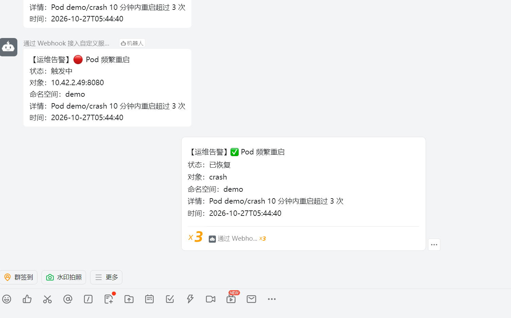

# k3s 一体化运维平台

在 2 台 2C4G 阿里云 ECS 上搭建的轻量级业务运维平台：k3s 集群承载 Flask + MySQL 业务，配套 Ingress、监控告警、日志与故障演练。

> 这是一个**学习 + 简历**项目，目标是完整走一遍「部署 → 观测 → 故障 → 复盘」的运维闭环。

## 架构

```
开发者 push ──▶ GitHub Actions ──▶ 镜像仓库(ghcr.io)
                                      │ kubectl set image
                                      ▼
┌──────────────────────────────────────────────────────────┐
│ k3s 集群（2 节点，172.26.0.0/20）                          │
│                                                          │
│  ns: demo                      ns: monitoring            │
│  ┌─────────┐  ┌──────────┐     ┌────────────┐            │
│  │ web ×1  │─▶│ mysql    │     │ Prometheus │            │
│  │ Flask   │  │ Stateful │     │ Alertmgr   │            │
│  └────┬────┘  └──────────┘     │ Grafana    │            │
│       │                        └─────┬──────┘            │
│       ▼                              ▼                   │
│   Traefik Ingress（80/443）      Webhook Relay ──▶ 钉钉    │
└──────────────────────────────────────────────────────────┘
```

## 技术栈

| 类别 | 组件 |
|---|---|
| 容器编排 | k3s v1.36.5（Kubernetes 轻量发行版） |
| 入口 | Traefik Ingress Controller（svclb 暴露 80/443） |
| 业务 | Python Flask + PyMySQL + prometheus_client |
| 数据库 | MySQL 8.0（StatefulSet + local-path 存储） |
| 监控 | Prometheus + Grafana（NodePort 30300）+ Alertmanager |
| 告警 | Grafana 告警规则 → Webhook Relay → 钉钉 |
| 配置管理 | Ansible（规划中） |
| 自动化 | GitHub Actions |

## 环境信息

| 角色 | 主机名 | 私网 IP | 公网 IP | 规格 | 磁盘 |
|---|---|---|---|---|---|
| master | master | 172.26.13.50 | 8.156.73.132 | 2 vCPU / 4 GiB | 40 GiB |
| worker | k3s-node1 | 172.26.13.51 | 8.156.68.82 | 2 vCPU / 4 GiB | 40 GiB |

- 地域：华东/西南（cn-chengdu），Ubuntu 22.04.5，内核 5.15
- 镜像加速：`/etc/rancher/k3s/registries.yaml`（docker.m.daocloud.io 等）
- 主机名曾于 10-27 变更，详见 [`drills/08-node-rename.md`](drills/08-node-rename.md)

## 进度

- [x] 双节点 k3s 集群，节点 Ready
- [x] 配置镜像加速，解决 docker.io 超时
- [x] Traefik Ingress 贯通（`pathType: Prefix`，浏览器 200）
- [x] Flask + MySQL 业务部署（`/api/time` 返回数据库时间，`/metrics` 暴露指标）
- [x] GitHub Actions 自动发布（push → ghcr 镜像 → 滚动更新 → 失败回滚）
- [x] Prometheus + Grafana 监控看板（8 个面板）
- [x] 告警链路（Grafana 规则 → Webhook Relay → 钉钉，4 条规则实测触发与恢复）
- [x] master 升配到 2C4G
- [x] 入口可用性探针（blackbox-exporter + Grafana 告警规则）
- [ ] Loki 日志查询
- [ ] 剩余故障演练（01–06）

## 当前状态（2026-10-27 晚）

**已完成**

| 项 | 说明 |
|---|---|
| 集群 | 2 节点 k3s v1.36.5，均 Ready，无异常 Pod |
| 业务 | Flask + MySQL，`/api/time` 三处入口均 200 |
| 入口 | Traefik + svclb，80/443 正常，`pathType: Prefix` |
| 监控 | Prometheus + Grafana（NodePort 30300），8 面板看板 |
| 告警 | 4 条业务规则（内存/磁盘/Pod 重启/5xx）+ 1 条入口探活规则 → Relay → 钉钉 |
| 探针 | blackbox-exporter 探 `http://<node-ip>/api/time`，30s 一次 |
| 复盘 | `drills/00`、`drills/07`、`drills/08` |
| 主机名 | 已固化 `master` / `k3s-node1`，幽灵节点已清理 |

**进行中 / 待处理**

1. **告警规则来源**：Grafana 规则由 `grafana-standalone.yaml` 的 provisioning 文件提供（`provenance=file`），
   `create-alerts.py` 是早期 API 方式，已不再需要，留着仅作参考
2. **Loki 日志**：未部署，Grafana 里还没有日志查询能力
3. **故障演练**：01–06 共 6 类未做（磁盘打满、Pod OOM、节点宕机、MySQL 不可用、误删配置、镜像拉取失败）
4. **flannel FDB 修复不持久**：08 号故障是手工补的表项，需重启 `k3s-agent` 验证能否自动重建
5. **6443 安全组**：当前对 `118.113.89.85` 开放，需确认是 `/32` 还是 `0.0.0.0/0`
6. **GitHub Actions 部署 job 会失败**：6443 未对 GitHub Runner 开放，属预期；要长期自动部署需自托管 Runner

**下次开工顺序**

1. 确认环境：`kubectl get nodes`、`kubectl -n monitoring get pods`、`curl http://127.0.0.1/api/time`
2. 做故障演练，每个记三个时间点（注入 / 告警 / 恢复），写进 `drills/` 并更新 `演练记录表.md`
3. 装 Loki + Promtail，Grafana 加日志数据源
4. 补 README 截图与演练汇总（平均发现时间、MTTR）

## 目录结构

```
k3s-ops-lab/
├── README.md
├── ansible/                  # 节点初始化 playbook（规划中）
├── app/                      # 业务应用
│   ├── app.py                # Flask 服务（/api/time、/metrics、/healthz）
│   ├── requirements.txt
│   ├── Dockerfile
│   └── k8s/                  # 00-namespace / 10-mysql / 20-web / 30-ingress
├── .github/workflows/        # build-deploy.yaml
├── monitoring/               # 监控配置
│   ├── values-prometheus.yaml
│   ├── grafana-standalone.yaml   # 独立 Grafana，含数据源与告警 provisioning
│   ├── blackbox.yaml         # 入口探针：blackbox-exporter + Probe
│   ├── create-alerts.py      # 早期 API 建规则脚本（已被 provisioning 取代）
│   ├── grafana-dashboard.json
│   └── feishu-relay/         # Webhook 转发（实际发钉钉，历史命名）
└── drills/                   # 故障演练与复盘
    ├── 演练记录表.md
    ├── 00-ingress-404.md
    ├── 07-node-maintenance.md
    └── 08-node-rename.md
```

## 监控与告警效果

Grafana 看板（8 个面板，数据来自 Prometheus）：


告警经 Grafana 规则 → Webhook Relay → 钉钉群推送，触发与恢复各有一次通知：




入口可用性由 blackbox-exporter 独立探测（不走应用自身的 `/metrics`，避免"应用自证健康"）：

```bash
# 探针状态：1=可用，0=不可用
kubectl -n monitoring port-forward svc/kube-prom-kube-prometheus-prometheus 9090:9090
curl -s 'localhost:9090/api/v1/query?query=probe_success'
```

### 入口告警实测（2026-10-27）

把 `blackbox-exporter` 缩容到 0 模拟探针失效，验证规则与钉钉链路端到端可用：

| 时间 | 事件 |
|---|---|
| 20:06:38 | 缩容到 0，探针停止上报 |
| 20:10:12 | 规则变为 firing，钉钉收到 1 条告警（relay 回执 200） |
| 20:11:08 | 恢复副本，探针重新上报 |
| 20:12:12 | 规则回到 inactive，钉钉收到 1 条恢复通知 |

发现耗时约 3 分半（1 分钟评估间隔 + 2 分钟 `for`），恢复通知在探针恢复后约 1 分钟送达。

> 排障备注：Grafana 13 的 provisioning 不会清理数据库里同名的遗留联系人，会让每次通知重复发两条。
> 本次删除了历史遗留的联系人，重启后确认只剩 `dingtalk-webhook` 一条。

## 快速开始

```bash
# 1. 部署业务（00 命名空间 → MySQL → web → Ingress）
kubectl apply -f app/k8s/

# 2. 验证
curl http://<node-ip>/api/time

# 3. 监控栈（Prometheus Operator + 独立 Grafana）
helm install kube-prom prometheus-community/kube-prometheus-stack \
  -n monitoring --create-namespace -f monitoring/values-prometheus.yaml
kubectl apply -f monitoring/grafana-standalone.yaml

# 4. 入口探针（blackbox-exporter + Probe + 告警规则）
kubectl apply -f monitoring/blackbox.yaml
```

> 注意：`Probe` 的 `probeNamespaceSelector` 为空时**不会**默认匹配自身命名空间，
> 必须在 Prometheus CR 里显式指定（已写入 `values-prometheus.yaml`），否则抓取任务不会生成。

## 故障演练记录

| 编号 | 主题 | 状态 |
|---|---|---|
| 00 | Ingress 404（pathType 不匹配） | ✅ |
| 01 | 节点磁盘打满 | ⬜ |
| 02 | Pod OOM | ⬜ |
| 03 | 节点宕机 | ⬜ |
| 04 | MySQL 不可用 | ⬜ |
| 05 | 误删配置 | ⬜ |
| 06 | 镜像拉取失败 | ⬜ |
| 07 | 节点停机变配（计划内，实际演变成故障） | ✅ |
| 08 | 主机名变更致节点重复注册（真实故障） | ✅ |

## 备注

- 本项目为个人学习用途，节点为单点 master，不具备生产高可用能力
- 存储使用 local-path（本地盘），数据随节点丢失，生产环境应使用云盘或分布式存储
- `feishu-relay` 是历史命名，代码里 `DINGTALK=1` 时才发钉钉；后续可统一改名为 `alert-relay`
